<a href="https://play.google.com/store/apps/dev?id=8090107179483981086">
  <picture><source media="(prefers-color-scheme: dark)" srcset="assets/hero-dark.svg"></picture>
</a>

  
  

<picture><source media="(prefers-color-scheme: dark)" srcset="assets/highlights-dark.svg"></picture>

## 🩺 Spotlight: FisioChecks

<a href="https://play.google.com/store/apps/details?id=com.confradestech.fisiochecks"><picture><source media="(prefers-color-scheme: dark)" srcset="assets/spotlight-dark.svg"></picture></a>

  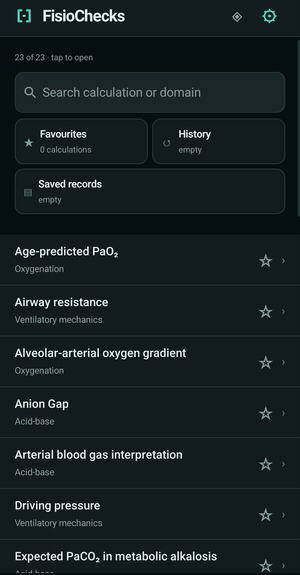
   FisioChecks on Android: pick a calculation, type the values, read the result.

Get it on <a href="https://play.google.com/store/apps/details?id=com.confradestech.fisiochecks">Google Play</a> · <a href="https://apps.apple.com/br/app/fisiochecks/id6812398536">App Store</a>

## 📱 More apps I designed, built and shipped

  <a href="https://play.google.com/store/apps/details?id=com.confradesTech.peacefuldreams.android"><picture><source media="(prefers-color-scheme: dark)" srcset="assets/app-peaceful-dreams-dark.svg">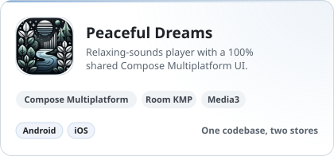</picture></a>
  <a href="https://play.google.com/store/apps/details?id=com.confradestech.osiris"><picture><source media="(prefers-color-scheme: dark)" srcset="assets/app-osiris-dark.svg">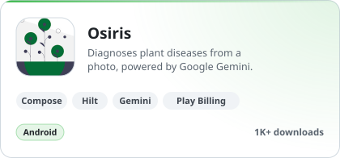</picture></a>

  <a href="https://play.google.com/store/apps/details?id=com.confradesTech.myDailyHumor"><picture><source media="(prefers-color-scheme: dark)" srcset="assets/app-my-daily-humour-dark.svg"></picture></a>
  <a href="https://github.com/joaquim-og/shiftskin"><picture><source media="(prefers-color-scheme: dark)" srcset="assets/app-shiftskin-dark.svg">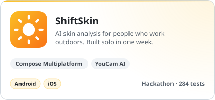</picture></a>

  <picture><source media="(prefers-color-scheme: dark)" srcset="assets/app-waterly-dark.svg">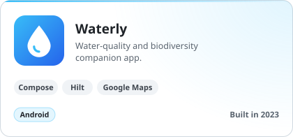</picture>
  <a href="https://play.google.com/store/apps/dev?id=8090107179483981086"><picture><source media="(prefers-color-scheme: dark)" srcset="assets/app-earlier-dark.svg">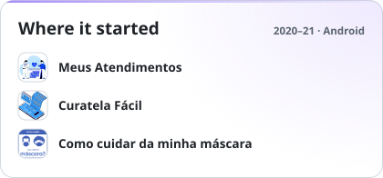</picture></a>

Tap a card to open the app. Peaceful Dreams is also on the <a href="https://apps.apple.com/br/app/peaceful-dreams/id6529560161">App Store</a>.

## 💬 What users say

  <picture><source media="(prefers-color-scheme: dark)" srcset="assets/review-my-daily-humour-dark.svg">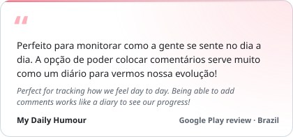</picture>
  <picture><source media="(prefers-color-scheme: dark)" srcset="assets/review-my-daily-humour-2-dark.svg">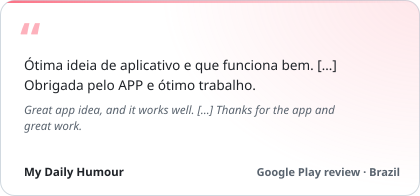</picture>

## 🛠️ What I build with

<picture><source media="(prefers-color-scheme: dark)" srcset="assets/stack-dark.svg"></picture>

## 🎓 Always learning

<picture><source media="(prefers-color-scheme: dark)" srcset="assets/certs-dark.svg">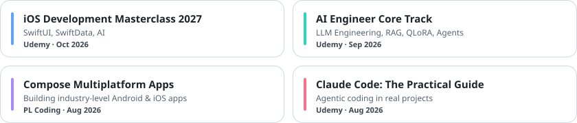</picture>

## ⚡ Right now

- 🩺 Growing **FisioChecks**, my clinical calculator for physiotherapists (KMP + Compose + SwiftUI)
- 🤖 Working spec-first with AI agents (OpenSpec + Claude Code)

<a href="https://www.linkedin.com/in/joaquimoliveiragomes/">
  <picture><source media="(prefers-color-scheme: dark)" srcset="assets/contact-dark.svg">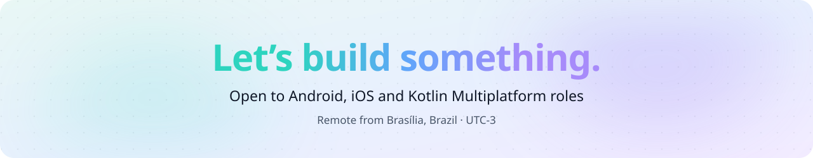</picture>
</a>

  
  

<picture><source media="(prefers-color-scheme: dark)" srcset="assets/footer-dark.svg"></picture>
